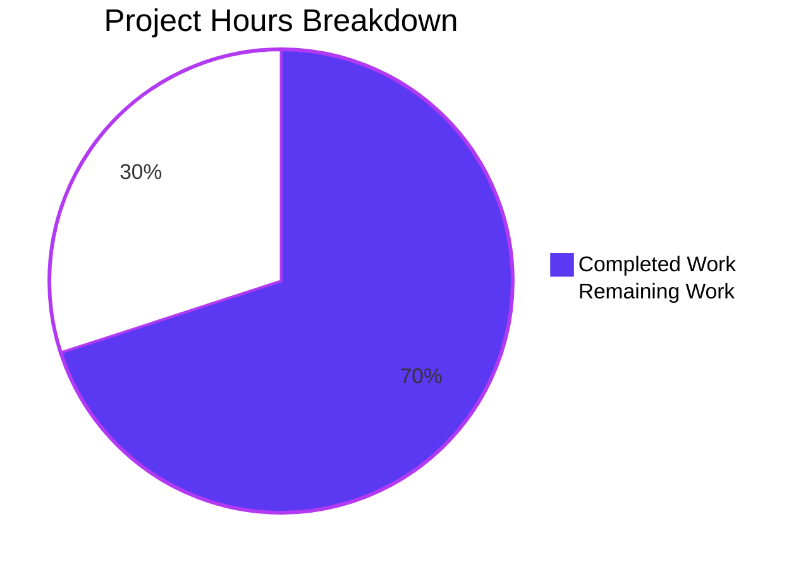
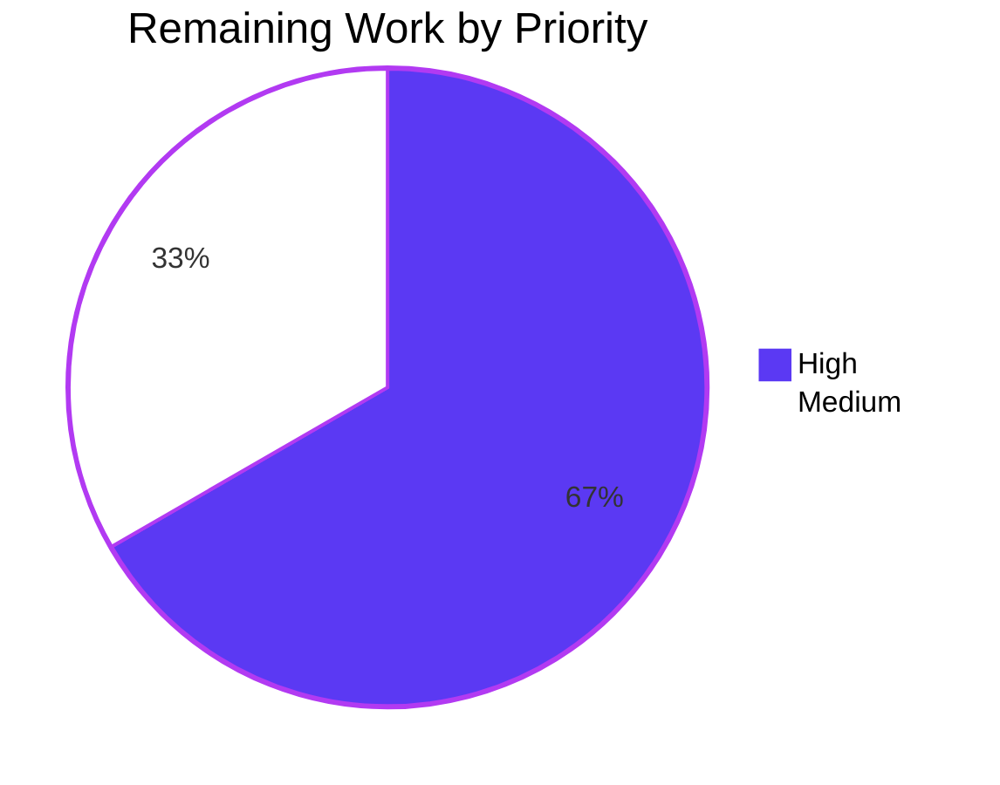

# 1. Executive Summary

## 1.1 Project Overview

This project replaces an existing Node.js HTTP server with an equivalent single-file Python 3 service at the repository root, `app.py`, answering every request with the same fixed payload. The objective is behaviour identity: the 14-byte body `Hello, World!\n`, status 200 for every path and each of the nine standard methods, a listener on port 3000, and the start-up line printed once, character for character. Callers depending on today's answers see no change. The scope is one 16-line file on Flask 3.1.3.

## 1.2 Completion Status



**70.0% complete** — 14 completed hours of 20 total hours: 14 ÷ (14 + 6) × 100.

| Metric | Hours |
|--------|-------|
| Total Hours | 20 |
| Completed Hours (AI + Manual) | 14 |
| Remaining Hours | 6 |

Every requirement is delivered and verified; the remaining hours cover the comparison with the original server, a regression net and production serving.

## 1.3 Key Accomplishments

- Whole application in one file at the repository root: 16 lines, importing only Flask (`app.py`).
- The fixed body `Hello, World!\n` returned byte-for-byte on every request.
- Status 200 for every path form and all nine methods, HEAD bodyless, OPTIONS carrying the body, and no redirect anywhere.
- The listener bound to `127.0.0.1:3000`, unreachable from any other address.
- The start-up line printed exactly once per invocation, character for character, by the file itself.
- The repository's other paths untouched; no manifest, test, comment or configuration added.

## 1.4 Critical Unresolved Issues

5 of the 40 requirements carry an open caveat, an accepted limit or unfinished verification; the other 35 are closed.

| Issue | Impact | Owner | ETA |
|-------|--------|-------|-----|
| The port has never been compared against the original server file | Source-level parity is unproven; the four behaviours rest on the one-line server definition supplied with the request | Codebase owner | 2 h |
| The start-up line's exactly-once property is conditional on a clean environment | An environment exporting `FLASK_DEBUG` prints the line twice and makes the framework's interactive debugger reachable | Operator | Part of the 2 h deployment task |
| A request target whose decoded form contains a carriage-return / line-feed pair is answered by the framework's 404 page | One target class differs from the original server's blanket 200 | Codebase owner | Accepted — no change planned |
| The service binds loopback only and runs on the framework's development server | It is not deployable beyond the local machine as it stands | Codebase owner | Part of the 2 h deployment task |
| No automated regression net exists | A future edit can break the contract with no check failing | Codebase owner | 2 h |

Three are courses recorded in Section 5.2; two are verification work this handover leaves.

## 1.5 Access Issues

No access issues identified: the interpreter carrying the pinned framework pair, the Node runtime and local network access were all available, and no credential or third-party service is involved.

## 1.6 Recommended Next Steps

1. **[High]** Compare the original server implementation with the four behaviours verified here — two hours, and the only claim resting on supplied input.
2. **[High]** Build the production serving path: a WSGI server, the pins declared in the deployment environment, and a deployed invocation that leaves debug mode off — two hours.
3. **[Medium]** Wrap the four behaviours in an automated suite so the contract survives the next edit — two hours.
4. **[Low]** Decide whether the decision record delivered with this change should also live in the repository — new scope.

# 2. Project Hours Breakdown

## 2.1 Completed Work Detail

| Component | Hours | Description |
|-----------|-------|-------------|
| Single-file port | 2 | The entire application in `app.py`: the Flask object with the built-in static route suppressed, the one-line nine-name method list, the two catch-all rules on one view, the view returning the fixed body, and the guarded entry point that prints the start-up line and runs the development server on port 3000. |
| Framework behaviour verification | 3 | Each of the four behaviours checked against the pinned framework's own documented behaviour before being relied on: the string return encoded to the body with nothing trimmed, the assumed 200, the port override with the loopback host default kept, and the debug/reloader semantics that keep the start-up line to one occurrence. |
| Acceptance verification on the running service | 4 | The four acceptance checks run against the live process: byte-level body capture per method, status collection across the nine methods, confirmation of the listening socket, and capture and counting of the start-up line — repeated across boots and from more than one working directory. |
| Coverage verification | 2 | Route-table and path-form verification: both rules exercised, `/static/...` confirmed answered by the view, trailing-slash and consecutive-slash forms confirmed redirect-free, OPTIONS confirmed to carry the body, HEAD confirmed bodyless. |
| Dependency, footprint and scope verification | 1 | Version and import inventory, the tracked-path comparison against the base commit, and the sweep confirming no manifest, test, documentation, comment, handler or configuration was added. |
| Security, output and exposure verification | 2 | The inert response under hostile headers, sized bodies and payload-shaped targets; the sensitive-data sweep over the output streams; the loopback-only exposure probes; and the dependency advisory check for the pinned pair. |
| **Total** | **14** | |

## 2.2 Remaining Work Detail

| Category | Hours | Priority |
|----------|-------|----------|
| Reconciliation of the port against the original server once the file is available | 2 | High |
| Production serving path: a production WSGI server, the dependency pin declared in the deployment environment, and a deployed invocation that keeps debug mode off | 2 | High |
| Automated parity regression suite for the four behaviours | 2 | Medium |
| **Total** | **6** | |

Section 2.1 (14 h) plus Section 2.2 (6 h) equals the 20 total project hours in Section 1.2, and the 6 remaining hours are the value plotted as remaining work in Section 7. The two High items are the critical path: until both are done the four behaviours describe a local process rather than a deployed service.

# 3. Test Results

The table below records what was exercised against the delivered file, by capability. Every figure is a check executed against the running service in this checkout; the repository carries no test suite — the project's scope deliberately excludes one — so there is no suite output to quote and no coverage instrumentation to read.

| Area / Category | Framework | Tests | Passed | Failed | Coverage | What This Proves |
|-----------------|-----------|-------|--------|--------|----------|------------------|
| HTTP contract — nine methods × seven path forms | Python 3.13 `http.client` | 63 | 63 | 0 | Not measured | Every standard method and path form reaches the one view and returns the fixed body at 200, with no redirect |
| Response body bytes | `curl` with `od` and `wc -c` | 2 | 2 | 0 | Not measured | The body is exactly 14 bytes ending in `0x0a`, unaltered by encoding |
| Framework controls — HEAD and OPTIONS | `http.client` and browser `fetch` | 4 | 4 | 0 | Not measured | HEAD is bodyless at 200 while still reporting `Content-Length: 14`, and OPTIONS carries the body with no `Allow` header |
| Path forms and redirects | `curl --path-as-is` | 7 | 7 | 0 | Not measured | Root, deep, trailing-slash, consecutive-slash, percent-encoded and `/static/...` targets are served directly, `redirects=0`, no `Location` header |
| Route table and path matching | Python URL-map introspection | 7 | 7 | 0 | Not measured | Exactly two rules cover every path form, one view answers them, no static route is registered, and no match raises a redirect |
| Out-of-contract targets under the accepted framework defaults | `curl` and a raw socket | 3 | 3 | 0 | Not measured | The framework's own 404 page answers a decoded carriage-return / line-feed target, its 400 page answers a raw space in the request line, and a percent-encoded NUL still returns the fixed body |
| Repository and utility gate | `node --check`, `node welcome.js`, `py_compile`, `git grep`, `git ls-files` | 8 | 8 | 0 | Not measured | The module compiles, the tree holds no placeholder or credential-shaped string, the file carries no comment, and the pre-existing utility is intact |
| Start-up, listener and browser end-to-end | Shell `grep`/`lsof` and headless Chrome | 27 | 27 | 0 | Not measured | One start-up line per invocation, a loopback-only listener on port 3000, and a real browser receiving the same 14 bytes on every URL with no redirect, no console error and no request leaving the host |
| **Total** | | **121** | **121** | **0** | | |

**Not covered.** No unit, integration or acceptance suite exists in the repository — the project's scope adds none — so the figures above are checks run by hand against the running service and no per-line coverage figure exists for this codebase. Beyond that, nothing exercises the service under concurrent production load, connection reuse, TLS, a reverse proxy, authentication or a data store, none of which it has. Behaviour under a process supervisor was not exercised, and the service was never restarted by one. The original server implementation could not be compared, so parity is proven against the specified behaviours rather than against that file's source. Failure paths are known by inspection rather than by test: a bind failure, and the start-up line under an environment that turns debug mode on. The exotic HTTP verbs the original parser accepted are outside the contract and were not tested.

# 4. Runtime Validation & UI Verification

Runtime validation was carried out against the delivered file started as a script from the repository root, and independently in a real headless browser against the same running process.

- ✅ **Server start-up** — the file run as a script prints the start-up line once and binds `127.0.0.1:3000`; reproduced on every boot.
- ✅ **Primary request flow** — both a raw client and a browser receive `Hello, World!\n` (14 bytes, ending `0x0a`) at status 200 on the root path.
- ✅ **All nine methods** — GET, HEAD, POST, PUT, DELETE, CONNECT, OPTIONS, TRACE and PATCH all answer 200 with the fixed body; HEAD is bodyless; OPTIONS carries the body with no `Allow` header.
- ✅ **Path coverage** — root, deep (`/deep/path`), trailing-slash (`/trailing/`), consecutive-slash (`//double//slash`), percent-encoded (`/a%2Fb`), query-string and `/static/x.css` all answer 200 with the identical body and no redirect.
- ✅ **Static-route suppression** — `/static/...` is answered by the catch-all view, never by a file-serving route and never with a 404.
- ✅ **Browser rendering** — the response renders as a single line of text on a blank page: the serialised document is `<html><head></head><body>Hello, World!\n</body></html>`, three elements in all, with no script, image or stylesheet requested.
- ✅ **Console and network** — the only console entry in the browser is Chromium's informational quirks-mode note, which follows from the payload having no `DOCTYPE`; every request was served 200, none left the loopback host, including the browser's automatic `/favicon.ico` request.
- ✅ **Listener exposure** — the socket is bound to `127.0.0.1:3000` only; the host's non-loopback address and the IPv6 loopback were both refused while the loopback address served.
- ⚠ **Start-up line as a readiness signal** — the line is emitted before the socket is bound, so a bind failure still prints it; and with debug mode on in the environment it is printed twice while the framework's interactive debugger becomes reachable. Pair the line with a listener check and run with a clean environment.
- ❌ **Never exercised** — there is no authentication, session, data store, outbound integration, TLS endpoint or production serving path to drive, so none was exercised; the service was never run under a process supervisor, and no load beyond a small concurrent burst was applied.

# 5. Compliance & Quality Review

## 5.1 Compliance Matrix

| # | Deliverable | Status | Evidence | Progress |
|---|-------------|--------|----------|----------|
| 1 | Whole application in one file at the repository root | ✅ PASS | `app.py`, 16 lines, Flask the only import; no second file, package or local import anywhere in the tree | Complete |
| 2 | Fixed response body, byte-for-byte | ✅ PASS | Body hex `48 65 6c 6c 6f 2c 20 57 6f 72 6c 64 21 0a`, 14 bytes, confirmed on the wire, in captured bodies and in the browser DOM | Complete |
| 3 | Status 200 for every path and each of the nine methods | ✅ PASS | 63-request sweep and two browser sessions, all 200; no 3xx, 404 or 405 for a registered method and path | Complete |
| 4 | Listener on TCP port 3000 | ✅ PASS | Socket owned by the started process on `127.0.0.1:3000`; port released on stop | Complete |
| 5 | Start-up line, character for character and once | ✅ PASS | Line byte-identical to the required text and counted once in every clean-environment invocation | Complete, with the environment caveat in 5.2 |
| 6 | Route and path coverage with no redirect | ✅ PASS | Two rules on one view; `/static/...`, deep, trailing-slash and consecutive-slash forms matched directly with `redirects=0` and no `Location` header | Complete |
| 7 | Framework-control parity for HEAD and OPTIONS | ✅ PASS | HEAD 200 with zero body bytes and `Content-Length: 14`; OPTIONS 200 with the body and no `Allow` header | Complete |
| 8 | Repository footprint and scope exclusions | ✅ PASS | One commit adding `app.py` (16 insertions, 0 deletions); `README.md` and `welcome.js` byte-identical; no test, documentation, manifest, dependency, CI, comment, handler, middleware or configuration added | Complete |
| 9 | Dependency discipline and advisory posture | ✅ PASS | Flask 3.1.3 with Werkzeug 3.1.9, nothing beyond the framework, and no published advisory whose affected range contains either pin | Complete |
| 10 | Security posture of the response | ✅ PASS | Inert under hostile headers, bodies and payload-shaped targets; no file served on any path, no reflection, no cookie, no secret in any body, header or stream | Complete |
| 11 | No dead code, placeholder or unfinished implementation | ✅ PASS | No TODO/FIXME/HACK marker, stub, `pass` or `NotImplementedError` anywhere in the tracked tree; every statement in the file is live, and the file matches its specification byte for byte | Complete |
| 12 | Explainability — a decision log and a traceability matrix for the non-trivial choices | ✅ PASS, with the delivery-location divergence recorded in 5.2 | Four-column decision log with 11 decisions, every cell populated, and 8 explicit deviation entries; bidirectional traceability matrix at 11/11 source and 10/10 target with no gaps; no rationale embedded in code comments | Complete |

## 5.2 AAP & Rule Divergences and Gaps

One user-specified rule governs this project — **Rule 1, Explainability**: every non-trivial decision documented with its rationale, delivered as a decision log with the alternatives, the reasoning and the risks; a bidirectional traceability matrix at 100% coverage for a migration such as this language port; an explicit entry for every deviation from a literal reading of the requirements; and no rationale in code comments. The plan the work was carried out against states that no user rules were provided, which is wrong, and the rules document governs. Every departure below is recorded with its cause: the first is a departure from that rule, the next four are courses the plan itself settled and that differ from the original implementation's behaviour, and the last three are gaps or statements in the plan the reader should not rely on.

| # | What the AAP/Rule Required | What Was Delivered Instead | Why It Diverged | Impact | Remediation |
|---|----------------------------|----------------------------|-----------------|--------|-------------|
| 1 | Rule 1: deliver the decision log and the traceability matrix as project artifacts | Both were delivered in this change's record rather than as a repository file | The plan forbids adding any documentation file to the tree and any comment to `app.py`, and the plan outranks the user's rules on an artifact's form | The rationale for the non-trivial choices is not visible to someone reading only the repository | None required; carrying it in-tree is new scope (Section 1.6) |
| 2 | Port the named source file, read from the repository | The port was written from the one-line server definition supplied with the request; no repository file was read | The file is not in the checkout and appears in no commit of any ref, so there was nothing to read | Parity rests on the supplied definition; a source-level comparison has never been possible | Read the real file when it is available and re-confirm the four behaviours (2 h) |
| 3 | The original server accepted connections on every interface | The process binds `127.0.0.1` only | The plan settled the interface question in favour of the framework's documented loopback default, which agrees with the text of the required start-up line | The service is reachable only from the local machine — narrower than the original | Add `host="0.0.0.0"` only if cross-host reach is wanted; that is a new decision, not a fix |
| 4 | The request named Flask alone; the plan excluded dependencies it did not name | The service runs on the framework's development server, and nothing in the repository declares the version pins | The plan forbids dependencies the request did not name and records the production serving path as a question to settle later | The service is not a deployment artifact as it stands, and a rebuilt runtime could resolve different pins | Choose and implement the production serving path and declare the pins before any use beyond the local machine (2 h) |
| 5 | The start-up line must be printed exactly once | The run call passes only the port, so the property holds while debug mode is off | The plan fixes the run call to a single keyword and excludes environment configuration and hardening | An environment exporting `FLASK_DEBUG` prints the line twice and makes the interactive debugger reachable | Run with a clean environment and treat the run call as security-relevant; close it in the production task |
| 6 | The fixed body was to be returned for every request target | A target whose decoded form contains a carriage-return / line-feed pair is answered by the framework's 404 page, and a malformed request line is answered 400 with that line echoed back | The plan declares malformed and unusual targets accepted framework defaults and forbids a 404 or error handler | One target class differs from the original's blanket 200; the echo returns only to the client that sent it | Accepted; handling it would need a custom converter or error handler the current scope excludes |
| 7 | The plan records that no user-specified rules were provided | The rules document holds Rule 1, and this work follows it | The plan's premise about the rules is wrong; the rules document is the authoritative source | A reader relying on the plan alone would not know the explainability requirements exist | Reflected here: the rule is satisfied and its delivery-location divergence is row 1 |
| 8 | The plan records the port verified on Python 3.13.16 | The work runs on Python 3.13.7 | This host provides 3.13.7, and the plan states the exact minor is not a requirement of the work | None on the deliverable: the file pins no interpreter and uses only syntax available from 3.9 onward | None; carry the framework pins and the interpreter version into the deployment environment |

**Divergence 1 — the explainability artifacts are delivered with the change rather than inside the repository.** Rule 1 asks for a decision log covering what was decided, the alternatives, why and the risks, plus a bidirectional traceability matrix. Both are complete: eleven decisions, every cell populated, eight deviation entries, and a full-coverage matrix in both directions. Neither is a repository file: the plan forbids adding any documentation file and outranks the rule on an artifact's form, while the rule's other half — no rationale in code comments — is honoured by a comment-free file. A reader holding only the repository sees sixteen lines and no statement of why its rules are shaped as they are (`app.py:3`, `app.py:8-9`).

**Divergence 2 — the named source file was never available to compare against.** The plan set out to port a specific file, and that file is in no commit of any ref of this repository, so no diff against it was possible and the port was written from the one-line server definition supplied with the request. Everything that definition shows is reproduced exactly (`app.py:3`, `app.py:5`, `app.py:8-11`, `app.py:15-16`), and every one of those behaviours was then observed on the running service. What remains open is whether the original carried anything the definition does not show. Read the real file, compare it with the behaviours in Section 3, and record the result — two hours.

**Divergence 3 — the process binds loopback only.** The original server's single listen call accepted connections on every interface; the delivered process binds `127.0.0.1` only, because the run call passes the port and no host (`app.py:16`). The plan settled that question that way, reasoning that it agrees with the required start-up line's own text. The consequence is plain: as delivered, the service is reachable only from the machine it runs on. If a container, sidecar or proxy must reach it, add `host="0.0.0.0"` to the run call — but that publishes an unauthenticated catch-all answering every path with the same body, so pair it with the work in Divergence 4.

**Divergence 4 — the service runs on the framework's development server, and nothing declares its versions.** The request named Flask alone and the plan excluded any dependency it did not name, so the serving path is the framework's own development server: no TLS, one process, and one request per connection. The repository declares no manifest or lockfile either, so the Flask 3.1.3 / Werkzeug 3.1.9 pair the four behaviours were verified against lives only in the environment. A production WSGI host importing the `app` object would serve the identical response but never print the start-up line, which lives in the module's guard. Choose a production WSGI server, declare the pins, keep debug mode off — two hours.

**Divergence 5 — the exactly-once start-up line is a property of the environment, not of the code.** The run call passes only `port`, so the framework takes its reloader setting from debug mode, which is off by default; one process therefore executes the module and prints the line once. With `FLASK_DEBUG` exported, a reloader child re-executes the module, the line is printed twice, and the interactive debugger becomes reachable on loopback. The plan fixes the run call and excludes environment configuration and hardening, so this is a recorded decision rather than an oversight — but one contract item and part of the process's exposure turn on a variable an operator controls. Keep the debug-related variables unset in the documented invocation.

**Divergence 6 — two out-of-contract target classes get the framework's pages instead of the fixed body.** A request whose decoded target contains a carriage-return / line-feed pair — `/a%0d%0aX:1`, for example — does not match the catch-all converter and receives the framework's 207-byte 404 page; a request line containing a raw space is rejected with `400 Bad request syntax`, whose page carries that line escaped and whose reason phrase mirrors it. The original ignored the target entirely and answered the fixed body for anything its parser accepted. The plan classifies such targets as accepted framework defaults and forbids a 404 or error handler, so no change was made; nothing is disclosed, and the 400 echo reaches only its author.

**Divergence 7 — the plan's own premise about the rules was wrong.** The plan asserts that no user-specified rules were provided and draws scope conclusions from that, while the rules document holds Rule 1. The practical effect is row 1: the explainability deliverables were not commissioned alongside the code and are carried in this change's record instead, while the repository's contents are unaffected either way, since the rule mandates no file path and the plan forbids adding one. Read the rules document rather than the plan's summary of it when judging how much rule compliance this project needs — and note that the rule's requirements are met in substance, as Section 5.1 records.

**Divergence 8 — the plan records a Python patch level this environment does not provide.** The plan states the work was verified on Python 3.13.16; this host runs 3.13.7, host-wide and in every isolated interpreter. The difference has no bearing on the deliverable: the file declares no interpreter, uses only syntax available from Python 3.9 onward, and was exercised here with every observable reproduced — the 14-byte body, 200 on all nine methods and every path form, the listener on port 3000, and one byte-identical start-up line per invocation. Recorded so nobody reads a patch-level guarantee into a claim that was never tested.

# 6. Risk Assessment

These are the ways this service could still fail in use, ordered by what would hurt first. None of them is an issue in the delivered behaviour under the invocation this project documents.

| Risk | Category | Severity | Probability | Mitigation | Status |
|------|----------|----------|-------------|------------|--------|
| No automated regression net: an edit can break one of the four behaviours without any check failing | Technical | Medium | Medium | Add the parity suite in Section 2.2 | Open |
| The dependency pins are declared only in the environment: a rebuilt runtime could resolve a different Flask or Werkzeug whose defaults the four behaviours depend on | Technical | Medium | Medium | Declare Flask 3.1.3 and Werkzeug 3.1.9 in the deployment environment | Open |
| Debug mode inherited from the environment re-executes the module: the start-up line prints twice and the interactive debugger becomes reachable | Security / Operational | Medium | Low | Run with a clean environment and treat the run call as security-relevant in review; close it in the production task | Open |
| The framework's development server is not built for production: one process, one request per connection, no TLS, version disclosure | Operational | High if exposed beyond loopback | Low while bound to loopback | Put a production WSGI server in front of it before any non-local use | Open |
| Exposure rests on a single argument: adding a host to the run call would publish an unauthenticated catch-all to every reachable network | Security | High | Low | Review any change to the run call; add authentication before broadening the bind | Open |
| Every path is answered with the fixed body, including conventional probe and monitoring paths, and there is no access-control or monitoring surface to enable | Security | Medium | Low | Keep the bind local; treat any exposure decision as new scope | Open |
| The framework's own output reflects attacker-supplied input: the access log on stderr echoes requested paths verbatim, and the 400 page mirrors a malformed request line to the client that sent it | Security / Operational | Low | Medium | Keep those streams inside the trust boundary; suppressing them is log configuration this scope excludes | Open |
| Parity with the original server is unverified at source level: the comparison rests on the one-line definition supplied with the request | Integration | Medium | Medium | Reconcile against the real file (Section 2.2, High priority) | Open |

**Accepted and not carried as risks:** the framework version banner, the absent security headers, the catch-all answer on monitoring paths, the bodyless HEAD response, the one-request-per-connection behaviour and the version-specific error pages are all accepted framework defaults under this project's scope, covered by the production-serving work above rather than by individual mitigations.

# 7. Visual Project Status


**70.0% complete** — 14 completed hours of 20 total hours, with 6 hours remaining. Blue denotes completed work and white the work still open.

**Remaining work by category**

| Category | Hours | Share of Remaining | Priority |
|----------|-------|--------------------|----------|
| Reconciliation against the original server implementation | 2 | 33.3% | High |
| Production serving path, dependency pins and start-up guard | 2 | 33.3% | High |
| Automated parity regression suite | 2 | 33.3% | Medium |
| **Total** | **6** | **100%** | |

**Priority distribution of the remaining 6 hours**



# 8. Summary & Recommendations

The delivered change is one 16-line file at the repository root, `app.py`, that reproduces the behaviour of an existing Node.js HTTP server on Python 3 with Flask. It is complete against everything it was scoped to do. The response body is the same 14 bytes ending in a newline, byte for byte; status 200 is returned for every path form exercised and for each of the nine standard HTTP methods, with HEAD correctly bodyless and OPTIONS carrying the body rather than the framework's automatic empty reply; the process listens on TCP port 3000; and the start-up line is emitted once, character for character, by the file itself. Alongside the four behaviours, the work suppressed the framework's built-in static route so no path is captured before the catch-all view, confirmed that trailing and consecutive slashes are served without a redirect, and recorded its non-trivial decisions — the framework and version choice, the suppressed static route, the pinned OPTIONS reply, the omitted slash-merging override, the rule pair, the placement of the start-up print, the port-only run call, the serving choice, the repository exclusions, the absent reference file and the carry-over rule — in a decision log with their alternatives and risks, together with a bidirectional traceability matrix accounting for every source construct and every line of the delivered file. No other repository path was touched, and no manifest, test, comment, configuration or build artifact was added.

Verification was direct rather than inferred: the running service was exercised with 121 checks that all passed — a 63-request sweep across nine methods and seven path forms, byte-level body capture, HEAD and OPTIONS assertions, the redirect-free path forms, the route table read from the running application, the out-of-contract targets, the repository and utility gate, the listener and start-up-line counts, and two independent headless-browser sessions that rendered the same single line on every URL with no redirect, no console error and no request leaving the loopback host. That work is what the 14 completed hours in Section 2.1 represent, and it is why the four behaviours can be relied on rather than merely read from the source. The project's completion stands at **70.0%** — 14 completed hours of 20 — because six hours of work remain that the delivered file does not cover.

The critical path to production is short and runs through three tasks. First, read the original server implementation and record the result of comparing it with the behaviours verified here; that closes the only claim in this project that rests on supplied input rather than on the repository. Second, build the production serving path: a production WSGI server, the Flask 3.1.3 / Werkzeug 3.1.9 pins declared in the deployment environment, and a deployed invocation that leaves debug mode off so the start-up line stays exactly once and the interactive debugger is never reachable. Third, wrap the four behaviours in an automated suite so the contract survives the next edit — the repository deliberately has no test file, so this is new work the owner takes on knowingly. Until the second item is done, the service should be treated as a local-only endpoint, which is exactly how it is bound today.

Success for this handover is easy to state and to check. The four behaviours hold on the running service; the repository holds one new file and nothing else; the pre-existing paths are untouched; the one line of output the contract specifies appears once per invocation; and every non-trivial choice is explained with its alternatives and risks in this change's record. All five have been demonstrated. The residual success conditions are the three tasks above, each with a clear closure criterion, and one decision the owner may take: whether to carry that decision record into the repository, which the project's original scope excluded and would be new scope.

The production readiness assessment is therefore: ready as a verified behaviour-equivalent port, not ready as a deployed service. Nothing in the delivered file is unfinished, and nothing in it needs correction under its scope; what stands between the current state and a production deployment is the serving path, the dependency declaration and the regression net — plus one decision about whether the endpoint must be reachable from other hosts. The open items in Section 1.4 and the divergences in Section 5.2 are the reader's checklist for that work.

# 9. Development Guide

This project has no build step, no manifest and no dependency of its own: the application is one file, and the runtime is already present. Every command below was run in this checkout, and the output shown is what it produced. Paths written as `"$HOME/..."` keep working files outside the repository, which is kept free of build artifacts.

### 9.1 System Prerequisites

- **Python 3** with Flask 3.1.3 and Werkzeug 3.1.9 — provided in this environment, verified as Python 3.13.7. The file uses only syntax available from Python 3.9 onward.
- **Node.js 22** (`v22.23.4` with npm `11.21.0`) — needed only for the repository's pre-existing `welcome.js` utility; the application does not use it.
- **`curl`** and **`lsof`** for the verification steps, and a POSIX shell.
- No compiler, no package-manager install step and no service such as a database, cache or broker is involved.

Confirm the runtime before anything else:

```bash
cd "$(git rev-parse --show-toplevel)"
python3 --version
python3 -c "import importlib.metadata as m; print('Flask', m.version('Flask'), '| Werkzeug', m.version('Werkzeug'))"
```

Expected output in this environment:

```
Python 3.13.7
Flask 3.1.3 | Werkzeug 3.1.9
```

### 9.2 Environment Setup and Dependencies

There is nothing to install: `app.py` imports only Flask, and the pinned pair is already resolvable by the interpreter. Verify that with:

```bash
python3 -c "import flask; print('flask import OK', flask.__file__)"
```

If you want an isolated interpreter anyway, create it outside the repository checkout and note the difference between the two kinds of environment:

```bash
python3 -m venv --system-site-packages "$HOME/app-py-env"     # sees the provided Flask 3.1.3
"$HOME/app-py-env/bin/python" -c "import importlib.metadata as m; print(m.version('Flask'))"

python3 -m venv "$HOME/app-py-env-isolated"                   # does NOT see Flask: 'No module named flask'
"$HOME/app-py-env-isolated/bin/pip" install flask==3.1.3      # needs PyPI access to populate it
```

No environment variable is required to run the application. `FLASK_DEBUG`, `FLASK_ENV`, `FLASK_APP` and `WERKZEUG_RUN_MAIN` must all be **unset**; see 9.6.

### 9.3 Application Startup

Run the file itself as a script — not the framework's own runner, because the start-up line lives inside the module's `__main__` guard and only a direct run prints it:

```bash
cd "$(git rev-parse --show-toplevel)"
python3 -u app.py > "$HOME/app.log" 2>&1 &
```

Wait for the listener, then confirm what is running:

```bash
for i in $(seq 1 60); do curl -s -o /dev/null --max-time 2 http://127.0.0.1:3000/ && break; sleep 0.25; done
lsof -i :3000 -sTCP:LISTEN -n -P
grep -c 'Server running at http://127.0.0.1:3000/' "$HOME/app.log"
```

Expected: the listener line shows `127.0.0.1:3000 (LISTEN)` owned by your `python3` process, and the count prints `1`. The captured log begins with the application's own line, followed by the framework's banner (` * Serving Flask app 'app'`, ` * Debug mode: off`) and, on standard error, the development-server warning and one access line per request. Match the exact expected line rather than assuming it is the only line, and pair it with the listener check: the line is printed **before** the socket is bound, so a log containing it is not proof that anything is listening.

Stop the instance by the pid that owns the listener, which is unambiguous even when the process was backgrounded as part of a compound command:

```bash
lsof -i :3000 -sTCP:LISTEN -n -P          # read the pid, confirm its cmdline ends in app.py
kill "$(lsof -ti :3000 -sTCP:LISTEN)"
```

### 9.4 Verification Steps

Each check below names what a correct result looks like.

```bash
# Body, byte for byte: 14 bytes ending in 0x0a
curl -s http://127.0.0.1:3000/ | od -An -tx1        # 48 65 6c 6c 6f 2c 20 57 6f 72 6c 64 21 0a
curl -s http://127.0.0.1:3000/ | wc -c              # 14

# Status for the root, HEAD being bodyless (200 and 0 bytes)
curl -s -I -o /dev/null -w '%{http_code} %{size_download}\n' http://127.0.0.1:3000/   # 200 0

# OPTIONS is answered by the view: the body is present and no Allow header is sent
curl -s -X OPTIONS -D - -o /dev/null http://127.0.0.1:3000/ | grep -iE '^(HTTP|Allow)'
curl -s -X OPTIONS -o /dev/null -w 'OPTIONS %{http_code} %{size_download}\n' http://127.0.0.1:3000/  # 200 14

# Path forms are served directly, with no redirect
for p in /deep/path /trailing/ //double//slash /static/x.css; do
  printf '%s -> ' "$p"
  curl -s --path-as-is -o /dev/null -w '%{http_code} redirects=%{num_redirects} location=%{redirect_url}\n' "http://127.0.0.1:3000$p"
done

# The catch-all answers a conventional monitoring path with the fixed body as well
curl -s -o /dev/null -w '%{http_code} %{size_download}\n' http://127.0.0.1:3000/health    # 200 14
```

The pre-existing utility and the module's syntax check:

```bash
node --check welcome.js                     # exits 0
node welcome.js | wc -l                     # 98000
PYTHONPYCACHEPREFIX="$HOME/pyc" python3 -m py_compile app.py   # exits 0, cache written outside the tree
rm -rf __pycache__                          # if you compiled without the prefix above
```

### 9.5 Example Usage

A nine-method sweep over several path forms, using only the standard library. Every request should return status 200; the eight body-bearing methods should return exactly the 14-byte body, and HEAD should return nothing.

```bash
python3 - <<'PY'
import http.client
METHODS = ["GET", "HEAD", "POST", "PUT", "DELETE", "CONNECT", "OPTIONS", "TRACE", "PATCH"]
PATHS = ["/", "/deep/path", "/trailing/", "//double//slash", "/static/x.css"]
failures = []
for method in METHODS:
    for path in PATHS:
        conn = http.client.HTTPConnection("127.0.0.1", 3000, timeout=10)
        conn.request(method, path)
        response = conn.getresponse()
        body = response.read()
        location = response.getheader("Location")
        conn.close()
        expected = b"" if method == "HEAD" else b"Hello, World!\n"
        if not (response.status == 200 and body == expected and location is None):
            failures.append((method, path, response.status, len(body), location))
print("requests:", len(METHODS) * len(PATHS))
print("failures:", failures or "none")
PY
```

Expected output:

```
requests: 45
failures: none
```

### 9.6 Troubleshooting

- **`Address already in use`, after the start-up line has already appeared.** The port is held by another process. Find it with `lsof -i :3000 -sTCP:LISTEN -n -P`, confirm from `/proc/<pid>/cmdline` that it is yours, and stop that pid. Remember the line is printed before the socket is bound, so a log containing it does not prove the socket was bound — always pair the line check with a listener check.
- **The start-up line appears twice, or the banner says `Debug mode: on`.** Something in the environment sets `FLASK_DEBUG`. Run with a clean environment, for example `env -u FLASK_DEBUG -u FLASK_ENV python3 -u app.py`. In debug mode the framework also exposes its interactive debugger, so leave the variable unset.
- **No start-up line at all.** You are using the framework's runner rather than the file. `flask run` never prints the line, because it lives in the module's `__main__` guard; run `python3 -u app.py` instead.
- **A `404` for a path that looks fine.** A request target whose decoded form contains a carriage-return / line-feed pair (for example `/a%0ab`) does not match the catch-all converter and is answered by the framework's default page. Percent-encoded targets without a CR-LF pair — including traversal-shaped ones — return the fixed body normally.
- **A `400` echoing your request line.** A raw space in the request line is not a valid HTTP target; the framework rejects it and mirrors the offending line in its reason phrase. No normal client emits one.
- **`__pycache__` appears in the repository.** Importing the module from the repository root writes a bytecode cache. Run with `PYTHONDONTWRITEBYTECODE=1`, set `PYTHONPYCACHEPREFIX` to a directory outside the tree, or delete the directory afterwards — the repository is kept free of build artifacts.
- **A client that assumes persistent connections stalls.** The development server closes each connection after one response (`Connection: close`); either open a connection per request or place a production server in front of it.
- **Port 3000 is fixed.** The contract pins it, so two instances cannot run on one machine at the same time.
- **Looking for tests, a linter or a coverage measurement?** This project adds none by design: there is no test suite, no formatter, no type checker and no coverage tooling, and no CI configuration.

# 10. Appendices

## Appendix A — Command Reference

| Purpose | Command |
|---------|---------|
| Run the application | `python3 -u app.py` (from the repository root) |
| Confirm the runtime | `python3 --version` / `python3 -c "import importlib.metadata as m; print(m.version('Flask'))"` |
| Start in the background with a captured log | `python3 -u app.py > "$HOME/app.log" 2>&1 &` |
| Wait until it answers | `for i in $(seq 1 60); do curl -s -o /dev/null --max-time 2 http://127.0.0.1:3000/ && break; sleep 0.25; done` |
| Confirm the listener | `lsof -i :3000 -sTCP:LISTEN -n -P` |
| Confirm the start-up line, once | `grep -c 'Server running at http://127.0.0.1:3000/' "$HOME/app.log"` |
| Read the body bytes | `curl -s http://127.0.0.1:3000/ \| od -An -tx1` |
| Check a method or path form | `curl -s -X OPTIONS -D - -o /dev/null http://127.0.0.1:3000/` |
| Stop your own instance | `kill "$(lsof -ti :3000 -sTCP:LISTEN)"` |
| Syntax-check the module | `PYTHONPYCACHEPREFIX="$HOME/pyc" python3 -m py_compile app.py` (then remove `__pycache__` if you compiled without the prefix) |
| Operate the pre-existing utility | `node welcome.js \| wc -l` (98000) |

## Appendix B — Port Reference

| Port | Protocol | Bound Interface | Purpose | Notes |
|------|----------|-----------------|---------|-------|
| 3000 | HTTP | `127.0.0.1` (loopback only) | The application's listener, fixed by the contract | One instance per machine; the process is unreachable from any other address |

No other port is opened by this project, and no outbound connection is made.

## Appendix C — Key File Locations

| Path | Role |
|------|------|
| `app.py` | The whole application: framework import, application object, method list, the two route rules, the view and the guarded entry point |
| `README.md` | Pre-existing repository readme, unchanged |
| `welcome.js` | Pre-existing Node utility that prints 98,000 lines; unrelated to the service, unchanged |
| `blitzy/documentation/` | Pre-existing project documentation, unchanged |

## Appendix D — Technology Versions

| Component | Version | Notes |
|-----------|---------|-------|
| Python | 3.13.7 | The file uses only syntax available from Python 3.9 onward |
| Flask | 3.1.3 | The only import in `app.py`; supplies the application object, route registration and development server |
| Werkzeug | 3.1.9 | Transitive dependency; supplies the response, routing and development-server behaviour |
| Node.js / npm | 22.23.4 / 11.21.0 | Needed only for the pre-existing `welcome.js` utility |
| Google Chrome | 156.0.8078.47 | Used for browser-side verification during this project |
| Git | 2.51.0 | Repository tooling, with Git LFS on `PATH` |
| lsof | 4.99.4 | Listener inspection in the verification steps |

## Appendix E — Environment Variable Reference

Nothing needs to be set. The application reads no environment variable.

| Variable | Required | Effect |
|----------|----------|--------|
| `FLASK_DEBUG` | Must be unset | Setting it turns debug mode on: the module is re-executed by a reloader child so the start-up line prints twice, and the interactive debugger becomes reachable |
| `FLASK_ENV` | Must be unset | Ignored by this framework version; set it to nothing for consistency with the documented invocation |
| `FLASK_APP` | Must be unset | Only meaningful to the framework's own runner, which does not print the start-up line |
| `WERKZEUG_RUN_MAIN` | Must be unset | Framework-internal reloader marker; when set externally the process prints the line and then fails to serve |
| `PYTHONDONTWRITEBYTECODE` | Optional | Set to `1` to stop a bytecode cache being written into the repository when the module is imported |
| `PYTHONPYCACHEPREFIX` | Optional | Point it outside the repository to keep any bytecode a compile check produces out of the tree |

## Appendix F — Developer Tools Guide

| Task | How |
|------|-----|
| Inspect the route table without starting a server | Load the module under a name other than `__main__` and iterate `app.url_map.iter_rules()`; each rule reports its path, methods, defaults and `provide_automatic_options` |
| Check whether a path matches, and whether it would redirect | Bind the URL map (`app.url_map.bind("127.0.0.1")`) and call `match(path)`: a match returns the endpoint and its arguments, while a redirect would raise instead of returning |
| Capture the start-up output | Redirect standard output to a file at start-up; the line is the first line written, ahead of the framework's banner |
| Keep the repository clean | Run anything that imports the module from outside the checkout, or with bytecode writing disabled, and delete any `__pycache__` afterwards |
| Re-run the full contract by hand | Follow Section 9.4: body bytes, HEAD, OPTIONS, the path forms, the listener and the start-up-line count |
| Test suites, linters, formatters, type checkers | None exist in this project and none is configured; the repository has no test file, no manifest and no CI definition |

## Appendix G — Glossary

| Term | Meaning |
|------|---------|
| **Parity item** | One of the four behaviours the port had to reproduce exactly: the fixed body, the status coverage, the port, and the start-up line |
| **Catch-all rule** | The route pattern that matches any path, including those containing slashes, so one view answers every request |
| **Path converter** | The framework's mechanism for matching a path segment; the converter used here accepts slashes, which is why trailing and consecutive slashes are served without a redirect |
| **Static route suppression** | Turning off the framework's built-in file-serving route so that `/static/...` requests reach the catch-all view instead of returning a 404 |
| **Automatic OPTIONS reply** | The framework's default behaviour of answering OPTIONS with an empty body and an `Allow` header; disabled here so OPTIONS returns the fixed body |
| **Reloader** | The framework's supervision of a child process that re-executes the module when files change; enabled only in debug mode, and the reason the start-up line stays at one occurrence |
| **Decision log** | The record of each non-trivial choice with the alternatives it had, the reasoning behind it and the risks it carries; delivered with this change rather than as a repository file |
| **Traceability matrix** | The two-way map between the constructs of the original server and the lines of `app.py`, with the reason recorded for anything dropped or added |
| **WSGI** | The Python interface between a web server and an application; a production server implementing it is the remaining deployment work |
| **Byte-for-byte** | Comparison of the exact bytes of the response body, including the trailing newline, with no trimming or re-encoding |
| **Loopback** | The local-machine network address (`127.0.0.1`); the only interface this service binds, so it is unreachable from other hosts |
